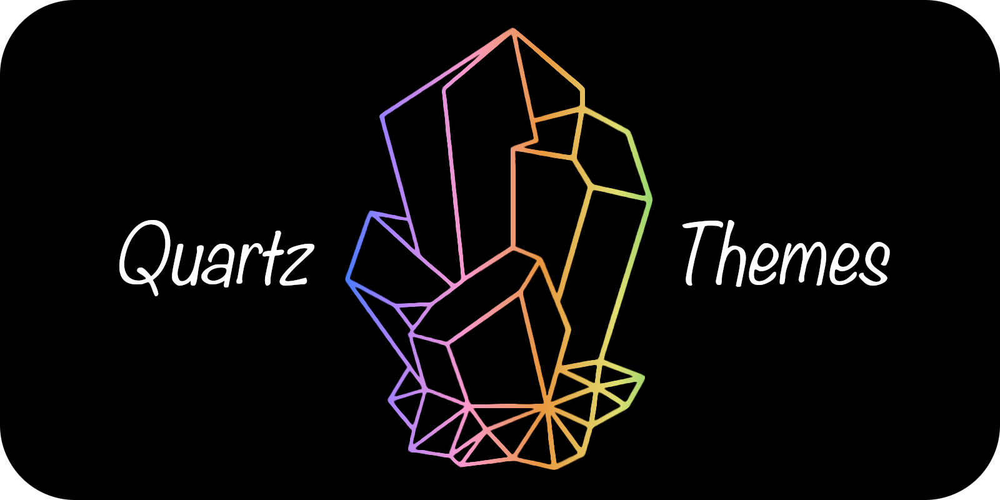

# Quartz Themes

Use any [Obsidian](https://obsidian.md/) community theme in [Quartz](https://github.com/jackyzha0/quartz).

<p align="center" width="100%">
  
</p>

## Installation (Quartz 5.2+)

```bash
npx quartz plugin add @quartz-themes/core
```

```yaml title="quartz.config.yaml"
plugins:
  - source: "@quartz-themes/core"
    enabled: true
    options:
      theme: Minimal # as listed in Obsidian's theme browser
      mode: both # or dark / light
      styleSettings: ./style-settings.json # optional: an export from the Style Settings plugin
```

At build time, [`@quartz-themes/core`](https://github.com/quartz-themes/core) downloads the theme (the same file Obsidian installs) and converts its CSS for Quartz. `theme` also accepts a GitHub repository (`owner/repo`), a URL, a local path, or a theme id from earlier versions. See the [core README](https://github.com/quartz-themes/core#readme) for all options.

Every theme in Obsidian's [community registry](https://github.com/obsidianmd/obsidian-releases/blob/master/community-css-themes.json) works, including new ones as soon as they're listed. No per-theme packages are needed any more.

## How well do themes transfer?

This repository measures it. The [fidelity harness](fidelity/README.md) renders the same notes in real Obsidian and in Quartz, then compares them element by element: headings, text, links, code, callouts, tables and more. It runs [weekly in CI](.github/workflows/fidelity.yml) over the whole registry.

Across about 700 themes in both modes, measured against Obsidian 1.15:

|                                  |       |
| -------------------------------- | ----- |
| Mean fidelity                    | 99.4% |
| Median                           | 100%  |
| Theme/mode pairs at 95% or above | 94%   |

The main known divergence is themes that choose fonts by operating system. A published site can't know its visitor's OS, so OS-specific rules are left out.

```sh
nix develop                          # Node, Chromium, e2e-headless (Obsidian on a private Xvfb display)
just build-site                      # build the specimen site (runner/vault) with a Quartz checkout
just fidelity "Minimal,Tokyo Night"  # Obsidian vs Quartz
just fidelity-all --shard=1/8        # the whole registry, sharded
just convert-all                     # convert every registry theme; check Quartz's minifier accepts it
```

## Quartz v4 (legacy)

The pre-generated v4 themes in [`themes/`](./themes/) are kept for existing Quartz v4 sites but are no longer updated.

To fetch one in GitHub Actions, add this step before the build in `deploy.yml`:

```yaml
- name: Fetch Quartz Theme
  run: curl -s -S https://raw.githubusercontent.com/saberzero1/quartz-themes/master/action.sh | bash -s -- <THEME-NAME>
```

To install one manually, copy `themes/<THEME-NAME>/_index.scss` to `quartz/styles/themes/_index.scss` and add `@use "themes";` after `@use "base";` in `quartz/styles/custom.scss`.

## Licenses

Quartz Themes is licensed under the [MIT License](LICENSE).

Themes are downloaded from their authors' repositories at build time and keep their own licenses. This repository doesn't redistribute them, apart from the frozen v4 builds in `themes/`.
